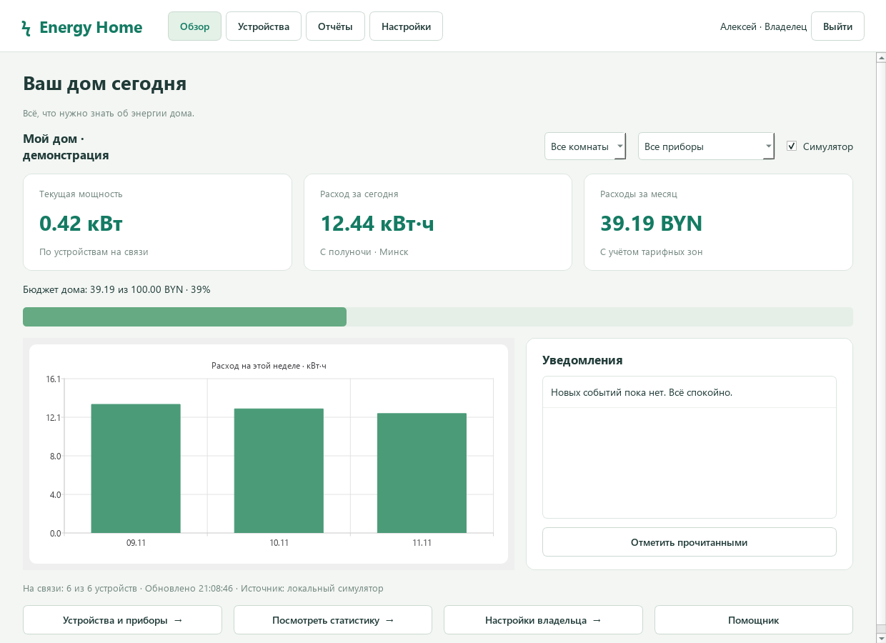

# Energy Home

Настольная система автоматизированного учёта и анализа энергопотребления дома
по `1laba_full.pdf`. Пять окон и их переходы соответствуют макетам раздела 5;
оформление адаптировано для рабочего приложения.

**Стек:** Python 3.12, PySide6 / Qt Widgets / Qt Charts, встроенный `sqlite3`, uv.
Сервер, браузер и отдельная СУБД не нужны.



## Запуск

Из корня проекта:

```powershell
uv sync --locked
uv run energy-home --demo
```

Нажмите **«Открыть демонстрационный дом»**. Доступны четыре комнаты, шесть приборов,
65 дней истории и симулятор показаний. Демо создаётся один раз и не перезаписывает
пользовательские дома.

| Роль | Логин | Пароль |
|---|---|---|
| Владелец | `owner@demo.local` | `Energy2026!` |
| Член семьи | `family@demo.local` | `Energy2026!` |

Для своего дома запустите `uv run energy-home` и выберите **«Зарегистрировать свой дом»**.
Регистрация создаёт владельца отдельной квартиры или частного дома. Членов семьи
владелец добавляет в настройках. Данные разных домов изолированы.

Альтернативный запуск и выбор базы:

```powershell
uv run python -m energy_home --demo
.\start.ps1 --demo
uv run energy-home --db data/another_home.sqlite3
```

Если uv отсутствует: [официальная установка uv](https://docs.astral.sh/uv/getting-started/installation/).
Проект выбирает Python 3.12 через `.python-version`; uv при необходимости загружает
интерпретатор. Для первой установки нужен доступ к PyPI. `uv.lock` фиксирует версии.
Запуск проверен в Windows. В Linux требуется графическое окружение с библиотеками Qt/xcb.

## Возможности

- **Вход и регистрация:** PBKDF2-хеши паролей, сеансы, ограничение повторных попыток входа.
- **Главная:** текущая мощность, расход сегодня, расходы за месяц, бюджет, недельный
  график, уведомления, фильтры по комнате и прибору.
- **Устройства:** дерево помещений, регистрация счётчиков / розеток / датчиков,
  серийные номера, режим работы, последняя связь, ручной ввод и импорт CSV.
- **Отчёты:** день / неделя / месяц, выбор даты, фильтры, график, вклад приборов,
  сравнение периодов, аномалии и рекомендации. Экспорт CSV и многостраничного PDF.
- **Настройки:** день/ночь, часы зон, бюджет в BYN, дневной лимит кВт·ч, уведомление
  на 80%, аварийная защита, семейный доступ и сценарии экономии.
- **Права:** член семьи читает показания, отчёты и уведомления. Все изменения доступны
  только владельцу. Роль и активность проверяются в бизнес-логике при каждом обращении.
- **Аномалии:** критическая мощность и рост относительно истории в тот же час.
  Критический скачок переводит прибор в аварийный режим и создаёт уведомление.
- **История:** показания, версии тарифов, аномалии, события, уведомления и факты
  экспорта сохраняются между запусками. Чтение уведомлений индивидуально для пользователя.

## Сценарии из PDF

1. **Текущее потребление:** откройте демо с симулятором. Показания обновляются раз в
   10 секунд. На главной выберите комнату или прибор. Данные старше 5 минут не
   участвуют в текущей мощности, но остаются в истории расхода.
2. **Анализ месяца:** откройте «Отчёты», выберите месяц и дату, нажмите «Построить».
   График показывает дни, таблица — вклад приборов. CSV / PDF сохраняют отчёт.
3. **Лимит:** уменьшите бюджет в настройках и сохраните. На 80% появляется предупреждение,
   на 100% — отдельное уведомление. Одинаковые уведомления не дублируются.
4. **Новый прибор:** добавьте помещение и устройство с уникальным серийным номером,
   внесите показание или загрузите CSV. Данные появятся в дереве и отчётах.

**Проверка защиты:** выберите демонстрационный прибор в штатном режиме и нажмите
«Проверить защиту». Тестовый скачок отражается в состоянии, уведомлениях и отчётах.
После устранения причины сброс оставляет прибор выключенным; включение выполняется
отдельно. При списании прибора история сохраняется.

## Показания и расчёты

Пакет содержит **начало интервала** с часовым поясом, длительность в секундах,
мгновенную мощность в Вт и **энергию за интервал** в кВт·ч. `energy_kwh` — приращение,
а не накопительное показание счётчика. Адаптер накопительного счётчика должен вычислять разность.

Пример: [examples/readings.csv](examples/readings.csv). Зарегистрируйте прибор с номером
`EXAMPLE-001` или замените номер в файле на свой. Разделители: `;` и `,`; кодировка UTF-8;
десятичный разделитель в CSV — точка.

```csv
serial;measured_at;power_w;energy_kwh;interval_seconds
EXAMPLE-001;2026-11-09T12:00:00+03:00;1000;1.0;3600
EXAMPLE-001;2026-11-09T13:00:00+03:00;500;0.5;3600
```

Интервалы одного устройства импортируются по времени. Дубли, пересечения, отрицательные
и нечисловые значения, даты без часового пояса и будущие интервалы отклоняются и
логируются. Корректные строки принимаются независимо от ошибочных. Допустимая длительность:
от 1 секунды до суток. При импорте в прибор отключите симулятор, чтобы интервалы не пересекались.

- БД хранит время в UTC; календарные периоды и тарифные зоны — `Europe/Minsk`.
- Интервалы делятся по часовым границам и моментам изменения тарифа. Расход через
  полночь корректно распределяется по дням. Энергия внутри интервала считается равномерной.
- Стоимость сохраняется с показанием: новый тариф действует с момента сохранения
  и не пересчитывает прошлые расходы.
- Текущие неполные периоды сравниваются с таким же прошедшим временем предыдущего.
  Полный месяц сравнивается с полным предыдущим месяцем. Без базы сравнения показывается «нет данных».
- Чтобы не суммировать одну энергию дважды, снимите **«Учитывать в итоге дома»** у
  контрольного общего счётчика, если расход учитывается по розеткам.
- Бюджет относится ко всему дому: фильтрация приборов не меняет базу проверки лимита.

Начальные тарифы 0,28 / 0,14 BYN — учебные, настройте свои. Дневная зона по умолчанию
07:00–23:00, ночная 23:00–07:00; часы можно изменить.

## Направления развития

В PDF они обозначены как расширения базовой системы:

1. **Умный дом и помощник:** протокол `SmartHomeAdapter`, HTTP-адаптер Home Assistant,
   чтение мощности и методы управления `switch`, разбор команд «текущее потребление»,
   «отчёт за месяц», «эко-режим», «отпуск», «ночной тариф». UI принимает текст команды;
   микрофонное распознавание и облачные адаптеры Алисы / Google Home не включены.
   Проверка Home Assistant в настройках выполняется в фоновом потоке. Токен не сохраняется
   на диск и очищается при выходе. Мгновенная мощность не подменяет интервальный учёт энергии.
2. **Общие зоны:** квартиры, площадь, жильцы, личный расход; распределение общедомового
   расхода по площади / жильцам / поровну, доли и итоговые кВт·ч. Сравнение энергоэффективности
   нормировано на площадь. Введите значения за один период; расчёт отделён от личного учёта дома.
3. **Автоматизация:** эко-режим, отпуск, ночной тариф, перенос гибкой нагрузки,
   планировщик и аварийная защита. Отметка «Не отключать в сценариях» защищает
   необходимые приборы от сценарного отключения. Планировщик работает при открытом
   приложении и авторизованном владельце.

Без оборудования отключения относятся к локальной модели. Автоматические команды
физическим реле не отправляются. Конкретное оборудование подключается через
`SensorGateway` и адаптер управления; для него нужны протокол и учётные данные.
Уведомления доставляются во встроенный список; SMS, почта и push не подключены.

## Структура

```text
src/energy_home/
  domain.py       сущности, роли, конечные автоматы устройств и окон
  storage.py      схема SQLite, транзакции, журнал событий
  auth.py         пароли, сеансы, регистрация и RBAC
  services.py     сбор, валидация, тарифы, управление, анализ, уведомления
  reports.py      агрегация, сравнения, рекомендации, экспорт
  gateways.py     асинхронная очередь пакетов, CSV, симулятор
  automation.py   правила, сценарии и планировщик
  extensions.py   умный дом, команды помощника, общие зоны
  demo.py         демонстрационная история
  ui/             пять окон Qt, виджеты и тема
  app.py          сборка приложения и CLI
tests/            бизнес-сценарии, расчёты, RBAC, сохранение, GUI и PDF
docs/             соответствие требованиям и снимки экранов
```

[Соответствие PDF и архитектура](docs/requirements.md). UI не выполняет SQL.
Внешний поток может поставить пакет в `SensorGateway`; обработка очереди и SQLite
выполняются в потоке приложения. Показание, сегменты, аномалия и уведомление сохраняются
в одной транзакции.

База: `data/energy_home.sqlite3`; технический лог — рядом. Для резервной копии
закройте приложение и скопируйте базу. Пользовательские данные, окружение и кеш uv
исключены из контроля версий.

## Проверка

```powershell
uv run pytest -q
uv run ruff check .
uv run ruff format --check .
uv run python scripts/preview.py
```

Снимки пяти окон создаются в `docs/screenshots/` на временной БД. GUI-тесты используют
offscreen Qt, HTTP-адаптер проверяется подставными ответами. Реальное оборудование
и внешние аккаунты для тестов не требуются.

Документация инструментов: [uv: проекты](https://docs.astral.sh/uv/guides/projects/),
[Home Assistant REST API](https://contributors.home-assistant.io/core/internals/rest-api/).
