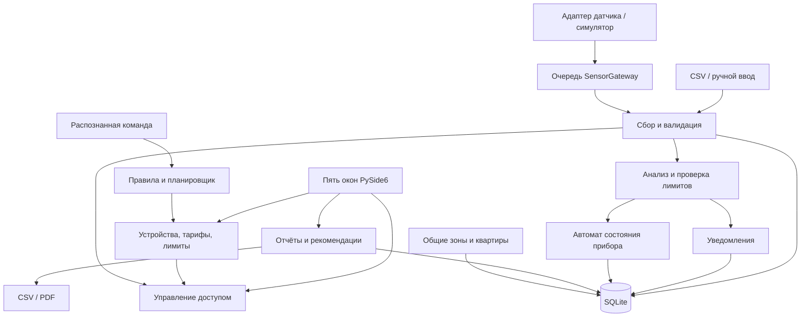
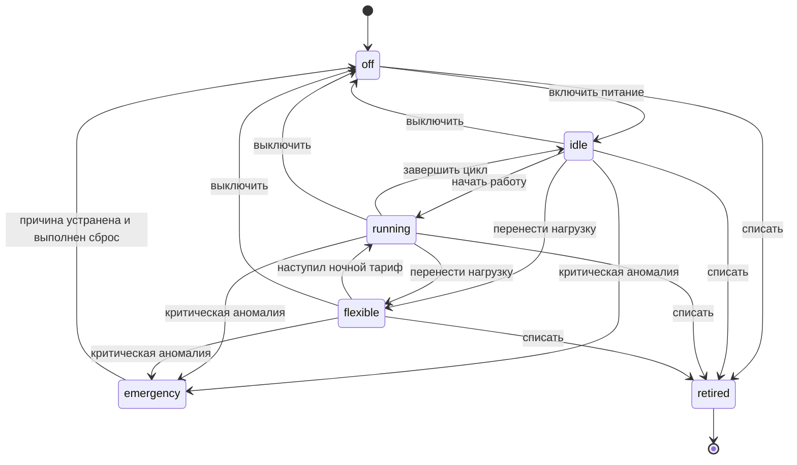

# Соответствие `1laba_full.pdf`

Проанализированы текст, диаграммы и макеты всех 20 страниц документа.
По запросу пользователя выбраны Python, uv и SQLite. Настольный PySide6 соответствует
пяти макетам и работает без отдельного сервера.

## Базовая система

| Раздел PDF | Требование | Реализация |
|---|---|---|
| 1.1 | Учёт, анализ, экономия | `EnergyService`, `ReportService`, рекомендации |
| 1.2, 1.4 | Владелец и член семьи, права при каждом запросе | `AccessControl.require`, роль и активность из БД |
| 1.3 | Шесть подсистем | Разделённые сервисы, хранилище, представление |
| 1.5.1 | Мощность, расход сегодня, детализация | Главная, фильтры комнат и приборов |
| 1.5.2 | Месяц, график, прошлый период, вклад приборов | Окно отчётов |
| 1.5.3 | Лимит расходов и предупреждение | Настройки, 80% / 100%, подавление дублей |
| 1.5.4 | Регистрация устройства и проверка поступления данных | Формы, дерево, последняя связь |
| 2.1.1 | Пользователь, роль, дом, комната, прибор, устройство | `users`, CHECK для роли, `homes`, `rooms`, `appliances`, `devices` |
| 2.1.1 | Показание, тариф, лимит | `readings`, `reading_segments`, `tariffs`, `settings` |
| 2.1.1 | Аномалия, уведомление, отчёт, событие | `anomalies`, `notifications`, `reports`, `events` |
| 2, бизнес-процесс | Валидация пакета, отклонение с журналированием | Проверка чисел, дат, интервалов и дубликатов |
| 3.2–3.3 | Асинхронный шлюз → учёт → БД → анализ → оповещение | `SensorGateway`, транзакционный `ingest` |
| 4.1 | Модель и отделённые подсистемы | Модель / сервисы / SQLite / UI |
| 5.1 | Жизненный цикл прибора | `DeviceState`, явная таблица `TRANSITIONS` |
| 5.2 | Переходы между пятью окнами | `Navigation`, дочерние окна через главную |
| 5.3.1 | Авторизация и регистрация | Окно входа и регистрация дома |
| 5.3.2 | Главное окно | Метрики, график, уведомления, профиль, выход |
| 5.3.3 | Дерево комнат и приборов | `QTreeWidget`, добавление и состояния |
| 5.3.4 | День/неделя/месяц, график, аномалии | Qt Charts, выбор даты и фильтров |
| 5.3.5 | Владелец: бюджет, тарифы, 80%, сохранить/отмена | Окно настроек и сервисная защита |
| 5.4.1 | Разделить UI, расчёты и БД | `ui/`, сервисы, `Database` |
| 5.4.2 | Шаблон состояния | Автоматы приборов и окон |
| 5.4.3 | RBAC в бизнес-логике | Проверки в сервисах, изоляция домов, отзыв сеансов |
| 5.4.4 | Аварийное обесточивание и уведомление | Критическая мощность → emergency + уведомление |
| 5.4.5 | Иерархия помещений и устройств | `rooms → appliances → devices`, дерево UI |

Раздел 1.2 кратко описывает права члена семьи, а Use Case на странице 11 дополнительно
разрешает ему просмотр отчётов. Реализация следует подробной диаграмме: данные
доступны для чтения, изменения — только владельцу.

## Три направления развития (1.6 и 4.2)

| Направление | Реализовано | Граница |
|---|---|---|
| Голос / умный дом | `VoiceCommand`, обработка текста, протокол адаптера, Home Assistant REST | Микрофон и облачные аккаунты Алисы/Google не подключены |
| Общие зоны | Квартиры, площадь, жильцы, распределение, сравнение кВт·ч/м² | Показатели вводятся вручную за одинаковый период |
| Умное управление | Эко, отпуск, перенос на ночь, планировщик, защита | Локальная модель, без автоматических команд физическим реле |

Эти направления в PDF обозначены как развитие системы. Для подключения конкретной
розетки нужны её протокол и учётные данные; демонстрация полностью работает локально.

## Архитектура

## Состояния прибора

При регистрации прибор создаётся в ожидании: питание устройства учёта считается
поданным. Прямой переход emergency → running запрещён. Списанный прибор больше
не принимает данные, но остаётся в истории.

## Принятые решения

- Единицы: мощность Вт / кВт, энергия кВт·ч. В макетах встречается «кВт/ч»;
  в приложении используется физически верное обозначение.
- Показание — интервальная энергия. Накопительные значения преобразуются в адаптере.
  Распределение энергии внутри интервала равномерное.
- UTC в хранилище, `Europe/Minsk` в календарных расчётах. Интервалы делятся по часам,
  полуночи и моментам вступления тарифов. Стоимость истории не пересчитывается.
- День задаётся парой часов, ночь проходит через полночь.
- Для полного месяца сравнивается полный предыдущий; для текущего — его сопоставимая
  прошедшая часть. При отсутствии базы процент не рассчитывается.
- Цены и расходы — SQLite REAL, округление выполняется для отображения.
  Это учебный учёт, не расчётный модуль энергоснабжающей организации.
- Аналитический скачок: мощность больше удвоенного среднего минимум пяти измерений
  в тот же час за 7 дней и больше половины номинальной. Критический скачок определяется
  отдельным порогом и при включённой защите аварийно обесточивает модель прибора.
- Двойной учёт общего счётчика и розеток исключается флагом включения в итог.
- Уведомления — встроенные. Почта, SMS и push не подключены.
- Планировщик и симулятор работают при открытом приложении и входе владельца.
- Home Assistant запрашивается в фоновом потоке с таймаутом, токен остаётся в памяти.

## Проверка

Тесты проверяют регистрацию и транзакционный откат, хеширование, RBAC и отзыв
доступа, изоляцию домов, день/ночь и версионирование тарифов, интервалы через полночь,
ошибки пакетов, критические и ночные скачки, дедупликацию и чтение уведомлений,
сценарии и ночной запуск, CSV/PDF, общие зоны, очередь шлюза, повторное открытие SQLite
и пять окон. Снимки интерфейса строятся на временной базе.
